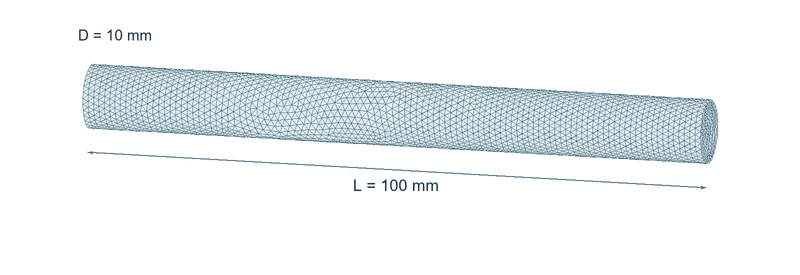

Acoustic eigenmodes of a closed cylindrical cavity
==================================================

問題の説明
----------

両端を閉じた円筒内の空気について、長手方向の定在波の固有振動数を求めます。
断面内で音圧が一様なモードには解析解があり、管の長さと音速から固有振動数を計算できます。ここでは、一様な音圧のモードと、それに続く軸方向の10モードをElmerで計算しました。

条件
----

円筒の内径は10 mm、長さ :math:`L` は100 mmです。軸を :math:`z` 方向にとり、両端と側面を剛壁とします。
剛壁では音圧の法線方向勾配がゼロとなるので、圧力を固定する節点は設けません。

   円筒の寸法とメッシュ。内部は1次四面体要素で分割しています。

.. list-table:: 計算条件
   :header-rows: 1

   * - 項目
     - 設定値
   * - 音速 :math:`c`
     - 340,000 mm/s
   * - 要素・節点
     - 1次四面体（Elmer 504）18,485要素、5,049節点
   * - ソルバ
     - Elmer 26.2 Release、WaveSolver
   * - 固有値の抽出
     - 絶対値の小さい順に11個

軸方向の次数を :math:`n` とすると、音圧の分布と固有振動数の解析解は次の通りです。

.. math::

   p_n(z) \propto \cos\!\left(\frac{n\pi z}{L}\right), \qquad
   f_n = \frac{n c}{2L}, \qquad n=0,1,2,\ldots

結果と考察
----------

Elmerの出力は角振動数の2乗 :math:`\lambda=\omega^2` です。正の固有値を :math:`f=\sqrt{\lambda}/(2\pi)` でHzに換算しました。
誤差は丸める前の値から :math:`100(f_\mathrm{Elmer}-f_\mathrm{ref})/f_\mathrm{ref}` で求めています。

.. csv-table:: 軸方向の固有振動数の比較
   :header: "軸方向次数 n", "理論値 [Hz]", "Elmer [Hz]", "誤差 [%]"

   0, 0, 0（ゼロモード）, —
   1, 1700, 1699.36, -0.038
   2, 3400, 3400.83, +0.025
   3, 5100, 5103.44, +0.067
   4, 6800, 6807.78, +0.114
   5, 8500, 8514.93, +0.176
   6, 10200, 10227.09, +0.266
   7, 11900, 11941.31, +0.347
   8, 13600, 13661.38, +0.451
   9, 15300, 15387.60, +0.573
   10, 17000, 17122.02, +0.718

:math:`n=0` は圧力が空間的に一定となるモードです。保存された最小固有値は :math:`-4.29\times10^{-6}\ \mathrm{s}^{-2}` で、理論上のゼロに相当します。この行の相対誤差は定義できません。
正の10モードでは、理論値に対する誤差の絶対値は最大0.718 %でした。

.. _cylindrical-cavity-mode-shapes:

音圧モード図
~~~~~~~~~~~~

出力1は一様音圧のゼロモードです。出力2～11では両端が音圧の腹となり、軸方向の次数と同じ数の節（白い帯）が現れます。
各図は保存した固有ベクトルの表面音圧を、モードごとの最大絶対値で正規化したものです。青が負、赤が正、白がゼロを表します。固有ベクトル全体の符号を反転しても同じモードです。

.. container:: row

   .. figure:: modes/cylindrical_cavity_mode_01.png
      :figclass: col-12 col-md-6
      :width: 100%
      :alt: 円筒全体で音圧が一定の分布

      出力1（軸方向0次・ゼロモード）　0 Hz

   .. figure:: modes/cylindrical_cavity_mode_02.png
      :figclass: col-12 col-md-6
      :width: 100%
      :alt: 円筒の軸方向に音圧の節が1個並ぶ分布

      出力2（軸方向1次）　1,699.36 Hz

   .. figure:: modes/cylindrical_cavity_mode_03.png
      :figclass: col-12 col-md-6
      :width: 100%
      :alt: 円筒の軸方向に音圧の節が2個並ぶ分布

      出力3（軸方向2次）　3,400.83 Hz

   .. figure:: modes/cylindrical_cavity_mode_04.png
      :figclass: col-12 col-md-6
      :width: 100%
      :alt: 円筒の軸方向に音圧の節が3個並ぶ分布

      出力4（軸方向3次）　5,103.44 Hz

   .. figure:: modes/cylindrical_cavity_mode_05.png
      :figclass: col-12 col-md-6
      :width: 100%
      :alt: 円筒の軸方向に音圧の節が4個並ぶ分布

      出力5（軸方向4次）　6,807.78 Hz

   .. figure:: modes/cylindrical_cavity_mode_06.png
      :figclass: col-12 col-md-6
      :width: 100%
      :alt: 円筒の軸方向に音圧の節が5個並ぶ分布

      出力6（軸方向5次）　8,514.93 Hz

   .. figure:: modes/cylindrical_cavity_mode_07.png
      :figclass: col-12 col-md-6
      :width: 100%
      :alt: 円筒の軸方向に音圧の節が6個並ぶ分布

      出力7（軸方向6次）　10,227.09 Hz

   .. figure:: modes/cylindrical_cavity_mode_08.png
      :figclass: col-12 col-md-6
      :width: 100%
      :alt: 円筒の軸方向に音圧の節が7個並ぶ分布

      出力8（軸方向7次）　11,941.31 Hz

   .. figure:: modes/cylindrical_cavity_mode_09.png
      :figclass: col-12 col-md-6
      :width: 100%
      :alt: 円筒の軸方向に音圧の節が8個並ぶ分布

      出力9（軸方向8次）　13,661.38 Hz

   .. figure:: modes/cylindrical_cavity_mode_10.png
      :figclass: col-12 col-md-6
      :width: 100%
      :alt: 円筒の軸方向に音圧の節が9個並ぶ分布

      出力10（軸方向9次）　15,387.60 Hz

   .. figure:: modes/cylindrical_cavity_mode_11.png
      :figclass: col-12 col-md-6
      :width: 100%
      :alt: 円筒の軸方向に音圧の節が10個並ぶ分布

      出力11（軸方向10次）　17,122.02 Hz

計算データ
----------

:download:`Elmer入力一式 <../../../benchmarks_data/acoustic/cylindrical_cavity/Elmer/input.zip>` を展開し、``case.sif`` とメッシュのあるディレクトリで ``ElmerSolver case.sif`` を実行します。入力の長さ単位はmmです。

* :download:`固有値の出力 <../../../benchmarks_data/acoustic/cylindrical_cavity/Elmer/eigenvalues.dat>` （:download:`列の定義とElmerのバージョン <../../../benchmarks_data/acoustic/cylindrical_cavity/Elmer/eigenvalues.dat.names>`）
* :download:`音圧固有モードのVTUファイル（ZIP） <../../../benchmarks_data/acoustic/cylindrical_cavity/Elmer/modes.zip>` 。ParaViewで ``pressure EigenMode1`` ～ ``pressure EigenMode11`` を選ぶと、各図の出力番号に対応するモードを表示できます。

計算・元資料：mmer547「Elmerの調査（1）音響固有値解析」第108回オープンCAE勉強会＠関西。
元の集計表と保存出力にはわずかな差があるため、掲載値はすべて同梱の固有値から換算しました。例えば軸方向10次は、元の集計表では17,116.99 Hz、保存出力では17,122.02 Hzです。
配布用の ``case.sif`` では方程式名を囲む引用符を半角にそろえました。この入力で11個の固有値が保存出力と一致することを確認しています。
