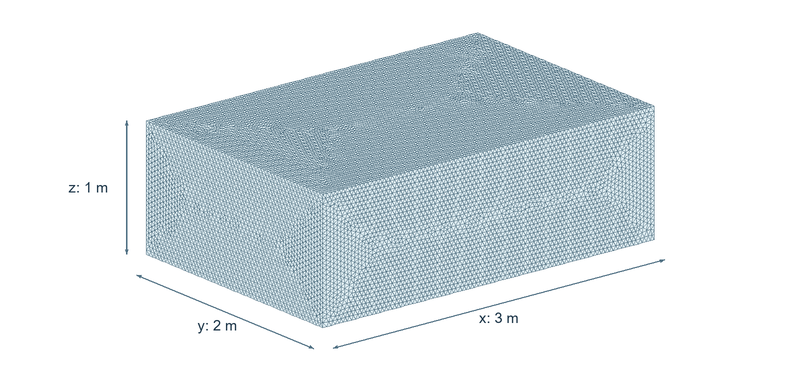

Acoustic eigenmodes of a rigid rectangular cavity
=================================================

問題の説明
----------

6面を剛壁で囲んだ直方体内の空気について、音圧の固有振動数を求めます。
直方体では3方向の寸法から固有振動数を計算でき、異なる方向の定在波が同じ振動数を持つ場合もあります。ここではゼロモードを含む低次の11個を解析解と比較します。

条件
----

計算に使用したメッシュの寸法は、:math:`x` 方向が3 m、:math:`y` 方向が2 m、:math:`z` 方向が1 mです。
全壁面で音圧の法線方向勾配をゼロとし、圧力を固定する節点は設けません。

   直方体の寸法とメッシュ。内部は1次四面体要素で分割しています。

.. list-table:: 計算条件
   :header-rows: 1

   * - 項目
     - 設定値
   * - 音速 :math:`c`
     - 340 m/s
   * - 要素・節点
     - 1次四面体（Elmer 504）233,201要素、49,007節点
   * - ソルバ
     - Elmer 26.2 Release、WaveSolver
   * - 固有値の抽出
     - 絶対値の小さい順に11個

:math:`(m,n,l)` をそれぞれ :math:`x,y,z` 方向の次数（0以上の整数）とすると、固有振動数の解析解は次の通りです。

.. math::

   f_{mnl}=\frac{c}{2}\sqrt{
       \left(\frac{m}{L_x}\right)^2+
       \left(\frac{n}{L_y}\right)^2+
       \left(\frac{l}{L_z}\right)^2}.

結果と考察
----------

保存した固有値 :math:`\lambda=\omega^2` を :math:`f=\sqrt{\lambda}/(2\pi)` でHzに換算しました。
誤差は丸める前の値から :math:`100(f_\mathrm{Elmer}-f_\mathrm{ref})/f_\mathrm{ref}` で求めています。
表の番号はParaViewの ``pressure EigenMode`` に付く番号と同じです。

.. csv-table:: 直方体の固有振動数の比較
   :header: "出力番号", "理論モード (m, n, l)", "理論値 [Hz]", "Elmer [Hz]", "誤差 [%]"

   1, "(0, 0, 0)", 0, 0.000019, —
   2, "(1, 0, 0)", 56.667, 56.676, +0.016
   3, "(0, 1, 0)", 85.000, 85.032, +0.038
   4, "(1, 1, 0)", 102.157, 102.215, +0.056
   5, "(2, 0, 0)", 113.333, 113.404, +0.062
   6, "(2, 1, 0)", 141.667, 141.817, +0.106
   7, 三重根, 170.000, 170.235, +0.138
   8, 三重根, 170.000, 170.239, +0.141
   9, 三重根, 170.000, 170.251, +0.148
   10, 二重根, 179.196, 179.488, +0.163
   11, 二重根, 179.196, 179.492, +0.165

最初のモードは空間的に一定の音圧に対応します。理論値が0 Hzであるため、この行の相対誤差は定義できません。
正の10モードの相対誤差はすべて0.2 %以内でした。

170 Hzでは :math:`(3,0,0), (0,2,0), (0,0,1)` の3モードが、179.196 Hz付近では :math:`(1,0,1), (1,2,0)` の2モードが同じ理論振動数を持ちます。
計算では170 Hzの3個が170.235～170.251 Hzに分かれました。重根の固有ベクトルは線形結合を取れるため、表では同じ理論振動数を持つモードをひと組として比較しています。

.. _rectangular-cavity-mode-shapes:

音圧モード図
~~~~~~~~~~~~

出力1は一様音圧のゼロモードです。出力7～9（三重根）と出力10～11（二重根）は、同じ理論振動数に対応する計算結果をそれぞれ出力順に示しています。
各図は保存した固有ベクトルの表面音圧を、モードごとの最大絶対値で正規化したものです。青が負、赤が正、白がゼロを表します。固有ベクトル全体の符号を反転しても同じモードです。

.. container:: row

   .. figure:: modes/rectangular_cavity_mode_01.png
      :figclass: col-12 col-md-6
      :width: 100%
      :alt: 直方体全体で音圧が一定の分布

      出力1（ゼロモード）　0.000019 Hz

   .. figure:: modes/rectangular_cavity_mode_02.png
      :figclass: col-12 col-md-6
      :width: 100%
      :alt: x方向の中央に節面が1つある音圧分布

      出力2（(1, 0, 0)）　56.676 Hz

   .. figure:: modes/rectangular_cavity_mode_03.png
      :figclass: col-12 col-md-6
      :width: 100%
      :alt: y方向の中央に節面が1つある音圧分布

      出力3（(0, 1, 0)）　85.032 Hz

   .. figure:: modes/rectangular_cavity_mode_04.png
      :figclass: col-12 col-md-6
      :width: 100%
      :alt: x方向とy方向に節面が1つずつある音圧分布

      出力4（(1, 1, 0)）　102.215 Hz

   .. figure:: modes/rectangular_cavity_mode_05.png
      :figclass: col-12 col-md-6
      :width: 100%
      :alt: x方向に節面が2つある音圧分布

      出力5（(2, 0, 0)）　113.404 Hz

   .. figure:: modes/rectangular_cavity_mode_06.png
      :figclass: col-12 col-md-6
      :width: 100%
      :alt: x方向に節面が2つ、y方向に1つある音圧分布

      出力6（(2, 1, 0)）　141.817 Hz

   .. figure:: modes/rectangular_cavity_mode_07.png
      :figclass: col-12 col-md-6
      :width: 100%
      :alt: 170 Hzの三重根に対応する1番目の数値固有モードの表面音圧分布

      出力7（三重根の1番目）　170.235 Hz

   .. figure:: modes/rectangular_cavity_mode_08.png
      :figclass: col-12 col-md-6
      :width: 100%
      :alt: 170 Hzの三重根に対応する2番目の数値固有モードの表面音圧分布

      出力8（三重根の2番目）　170.239 Hz

   .. figure:: modes/rectangular_cavity_mode_09.png
      :figclass: col-12 col-md-6
      :width: 100%
      :alt: 170 Hzの三重根に対応する3番目の数値固有モードの表面音圧分布

      出力9（三重根の3番目）　170.251 Hz

   .. figure:: modes/rectangular_cavity_mode_10.png
      :figclass: col-12 col-md-6
      :width: 100%
      :alt: 179.196 Hzの二重根に対応する1番目の数値固有モードの表面音圧分布

      出力10（二重根の1番目）　179.488 Hz

   .. figure:: modes/rectangular_cavity_mode_11.png
      :figclass: col-12 col-md-6
      :width: 100%
      :alt: 179.196 Hzの二重根に対応する2番目の数値固有モードの表面音圧分布

      出力11（二重根の2番目）　179.492 Hz

計算データ
----------

:download:`Elmer入力一式 <../../../benchmarks_data/acoustic/rectangular_cavity/Elmer/input.zip>` を展開し、``case.sif`` とメッシュのあるディレクトリで ``ElmerSolver case.sif`` を実行します。入力の長さ単位はmです。

* :download:`固有値の出力 <../../../benchmarks_data/acoustic/rectangular_cavity/Elmer/eigenvalues.dat>` （:download:`列の定義とElmerのバージョン <../../../benchmarks_data/acoustic/rectangular_cavity/Elmer/eigenvalues.dat.names>`）
* :download:`音圧固有モードのVTUファイル（ZIP） <../../../benchmarks_data/acoustic/rectangular_cavity/Elmer/modes.zip>` 。ParaViewで ``pressure EigenMode1`` ～ ``pressure EigenMode11`` を選ぶと、各図の出力番号に対応するモードを表示できます。

計算・元資料：mmer547「Elmerの調査（1）音響固有値解析」第108回オープンCAE勉強会＠関西。
設定の参考資料はStefano Tronciによる `Rigid Walled Room Revisited – Part 1 <https://computational-acoustics.gitlab.io/website/posts/15-rigid-walled-room-revisited-part-1/>`_ （2020年）です。
